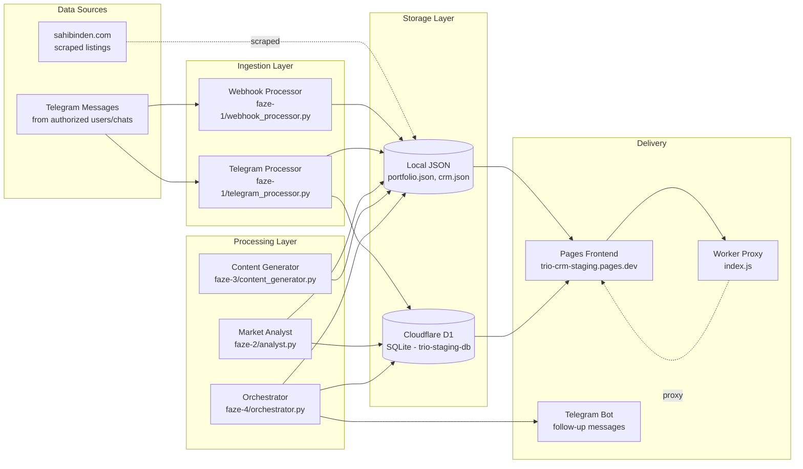
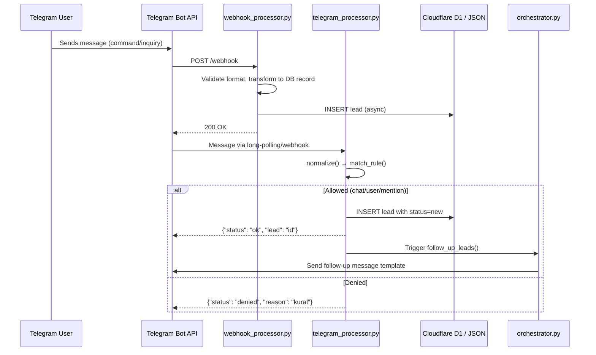
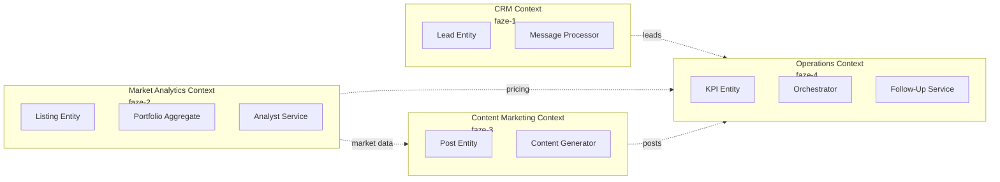

# TrioPrime Architecture

*Generated from Phase 0 Discovery — 2026-11-10*

---

## Layer Map & Dependency Rule

```mermaid
%% docs/ARCHITECTURE.md ## Layer Map
graph TD
    subgraph Delivery [Delivery / Interfaces]
        TG[Telegram Bot\nwebhook_processor.py]
        WK[Cloudflare Worker\nindex.js]
        PG[Pages Frontend\nindex.html + JS]
    end

    subgraph Adapters [Interface Adapters]
        D1[(Cloudflare D1\nSQLite via binding)]
        JSON[Local JSON Files\nportfolio.json, crm.json]
        HF[Hugging Face API\n(faze-1 webhook)]
    end

    subgraph UseCases [Use Cases / Application]
        UC1[Message Processor\ntelegram_processor.py]
        UC2[Market Analyst\nanalyst.py]
        UC3[Content Generator\ncontent_generator.py]
        UC4[Orchestrator\norchestrator.py]
    end

    subgraph Domain [Domain / Entities]
        LEAD[Lead\nchat_id, user_id, text]
        LISTING[Listing\nid, price, location, m2]
        PORTFOLIO[Portfolio\nindexed items, price_sqm]
        KPI[KPI Report\nleads, follow_ups, stories]
    end

    %% Dependency Rule: arrows point INWARD only
    TG --> UC1
    WK --> PG
    
    UC1 --> D1
    UC1 --> JSON
    UC1 --> HF
    
    UC2 --> JSON
    UC2 --> D1
    
    UC3 --> JSON
    UC3 --> D1
    
    UC4 --> JSON
    UC4 --> D1
    UC4 --> TG

    %% Domain references (read-only from UseCases)
    UC1 --> LEAD
    UC2 --> LISTING
    UC2 --> PORTFOLIO
    UC3 --> LISTING
    UC4 --> LEAD
    UC4 --> KPI
```

---

## Data Flow



---

## Deployment Topology

```mermaid
%% docs/ARCHITECTURE.md ## Deployment Topology
graph TB
    subgraph Cloudflare [Cloudflare Global Network]
        subgraph Pages [Cloudflare Pages]
            PF[Static Frontend\nindex.html + JS + data/]
            PF_A[trio-crm-staging.pages.dev\nc640d55e.trio-crm-staging.pages.dev]
        end
        
        subgraph Workers [Cloudflare Workers]
            WK_PROXY[Worker Proxy\nworker/index.js]
            WK_API[Phase Workers\n(faze-1/2/3/4 wrangler)]
        end
        
        subgraph D1_DB [D1 Database]
            D1_PRIM[(trio-staging-db\nPrimary - 02a1a148...)]
            D1_PREV[(Preview DB\nsame ID)]
        end
        
        subgraph KV_R2 [KV / R2 Storage]
            KV[KV Namespace\n(session, config)]
            R2[R2 Bucket\n(images, assets)]
        end
    end
    
    subgraph External [External Services]
        SB[sahibinden.com\nlisting source]
        TG_API[Telegram Bot API\nwebhook endpoint]
        HF_API[Hugging Face API\nAI processing]
    end

    Users[Users / Admins\n(Gökcan, Ozancan)] -->|HTTPS| PF_A
    PF_A -->|API calls| WK_PROXY
    WK_PROXY -.->|proxy to| PF_A
    
    WK_API --> D1_PRIM
    WK_API --> D1_PREV
    WK_API --> KV
    WK_API --> R2
    
    TG_API -->|webhook| WK_API
    SB -.->|scrape| WK_API
    HF_API -.->|inference| WK_API
```

---

## Dependency Graph (Phase Modules)

```mermaid
%% docs/ARCHITECTURE.md ## Dependency Graph
graph TD
    %% faze-1: Data Flow + CRM Sync
    F1_TP[.worktrees/faze-1/telegram_processor.py]
    F1_WP[.worktrees/faze-1/webhook_processor.py]
    F1_WP --> F1_TP
    
    %% faze-2: Market Analyst
    F2_A[.worktrees/faze-2/analyst.py]
    F2_PDB[.worktrees/faze-2/portfolio_db.py]
    F2_A --> F2_PDB
    
    %% faze-3: Content Generator
    F3_CG[.worktrees/faze-3/content_generator.py]
    F3_SMP[.worktrees/faze-3/social_media_posts.py]
    F3_CG --> F3_SMP
    
    %% faze-4: Full Orchestration
    F4_O[.worktrees/faze-4/orchestrator.py]
    F4_OLD[.worktrees/faze-4/old_born_patterns.py]
    
    %% Cross-phase dependencies (data flow)
    F1_TP -.->|leads.json| F4_O
    F2_A -.->|portfolio.json| F4_O
    F3_CG -.->|content| F4_O
    
    %% Shared data
    DATA_L[listings.json\n(sunumu/data/)]
    DATA_P[portfolio.json\n(data/)]
    
    F2_PDB --> DATA_P
    F2_A --> DATA_L
    F3_CG --> DATA_L
    F4_O --> DATA_L
    
    style F1_TP fill:#e3f2fd,stroke:#1565c0
    style F2_A fill:#e8f5e9,stroke:#2e7d32
    style F3_CG fill:#fff3e0,stroke:#ef6c00
    style F4_O fill:#fce4ec,stroke:#c2185b
    style DATA_L fill:#f3e5f5,stroke:#7b1fa2
    style DATA_P fill:#f3e5f5,stroke:#7b1fa2
```

---

## Hot Path Sequence (Lead Capture → CRM)



---

## Bounded Context Map (DDD-style)



---

## Key Architectural Decisions

| Decision | Context | Trade-off |
|----------|---------|-----------|
| **Git Worktrees per Phase** | Isolation of faze-1/2/3/4 | Duplication of wrangler.jsonc, shared data via parent |
| **JSON Files as Primary DB** | Simplicity, no migration needed | No ACID, concurrent write risk, scales poorly |
| **Cloudflare D1 as Secondary** | Managed SQLite, edge deployment | Limited query capability, preview/prod same DB |
| **Telegram as Primary Interface** | User preference, real-time | Vendor lock-in, rate limits, no rich UI |
| **Static Pages + Worker Proxy** | Free tier, global CDN | Worker adds latency, no server-side rendering |
| **Python for Data Processing** | Team expertise, pandas/ML ready | Cold starts in Workers, bundle size |

---

## Improvement Opportunities (from Discovery)

1. **Phase 1 — Characterization Tests**: No tests exist. Add pytest for `telegram_processor.py`, `analyst.py`, `portfolio_db.py` before refactoring.
2. **Phase 2 — Clean Architecture**: Extract `LeadRepository`, `ListingRepository`, `PortfolioRepository` interfaces; implement D1 + JSON adapters.
3. **Phase 3 — Design Philosophy**: Apply "Tell, Don't Ask" to `analyst.py` (currently anemic domain model).
4. **Phase 4 — Refactoring**: `orchestrator.py` does too much — split into `MarketScanService`, `FollowUpService`, `KPIReportService`.
5. **Phase 5 — System Design**: Add Redis (Cloudflare KV) for caching portfolio queries; add rate limiting for Telegram webhook.
6. **Phase 6 — DDIA**: Add idempotency keys for lead creation; implement outbox pattern for follow-up messages.
7. **Phase 7 — Release**: Add GitHub Actions for wrangler deploy per phase; add preview deployments.
8. **Phase 8 — Pragmatic**: Add `make` targets for common tasks; document runbooks for common operations.